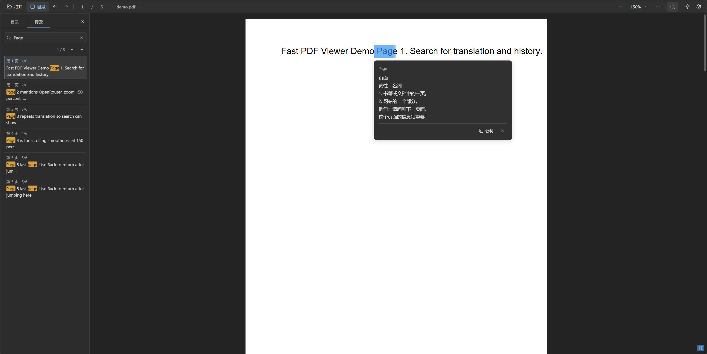

# Fast PDF Viewer – AI Translation

<p align="center">
  <strong>为技术文档而生的轻量 PDF 阅读器</strong> —— 极速打开、连续滚动、层级目录定位、全文侧栏搜索、划词 AI 翻译与双主题切换。
</p>

<p align="center">
  <a href="https://stewart222b.github.io/fast-pdf-viewer/">在线体验 Web 阅读器</a>
  ·
  <a href="https://github.com/Stewart222b/fast-pdf-viewer">GitHub</a>
</p>

<p align="center">
  
</p>

> 轻量本地 PDF 阅读器，支持目录、全文搜索、历史导航、划词 AI 翻译和深浅色主题。PDF 阅读过程在本地完成。

---

## 核心特性

| 功能模块 | 特性说明 |
| :--- | :--- |
| **快速打开与滚动** | 基于 pdf.js 按需渲染和动态缓存，针对大型文档与连续滚动进行优化。 |
| **目录与章节定位** | 树状目录展示，支持展开/折叠，并能精确高亮当前章节。 |
| **侧栏全文搜索** | 提供命中列表、结果计数、摘要高亮和逐项跳转。 |
| **问文档** | 侧栏「问答」一问一答：本地按整本检索，把命中窗或抽样页打包后发给同一套 OpenAI 兼容 API；引用可跳到原文并高亮。 |
| **历史导航** | 支持前进、后退以及跳转后返回原阅读位置。 |
| **主题与阅读进度** | 支持深色/浅色主题，并在本地记住主题和阅读位置。 |
| **划词 AI 翻译** | 选中文本后点击「译」按钮发起请求，支持流式输出、重试、复制和模型筛选；可在设置中启用自动翻译。 |
| **多语言** | 8 种界面语言、24 种翻译目标语言；首次使用按浏览器语言选择界面，也可手动设置。翻译质量取决于所选模型。 |
| **桌面与 Web** | 支持原生窗口、本地浏览器模式和 GitHub Pages Web 版；PDF 阅读过程在本地完成。 |

---

## 快速开始

### Chrome / Edge 扩展

扩展沿用同一套阅读器，可打开本地 PDF，并提供在线 PDF 链接的手动打开入口和可选的自动接管。

工具栏提供整份 PDF 的下载／保存副本按钮，也可使用 `Ctrl+S` / `Cmd+S`。打印请使用浏览器原生 PDF 阅读器。

```bash
python desktop/bootstrap_pdfjs.py
node scripts/build-extension.mjs --zip
```

在浏览器扩展管理页启用开发者模式，选择“加载已解压的扩展程序”，加载 `dist/browser-extension/`。
安装后在“扩展设置”中开启“自动打开 PDF”。不同浏览器的接管能力、安装步骤和发布前验证项目见 [扩展说明](docs/browser-extension.md)。

`dist/browser-extension.zip` 是分发包；商店上架需要另外提交和审核。

### 在线体验（无需安装）

在浏览器中打开 **[https://stewart222b.github.io/fast-pdf-viewer/](https://stewart222b.github.io/fast-pdf-viewer/)**，点击打开文件或将 PDF 拖入窗口即可。页面由仓库 `web/` 目录经 GitHub Pages 发布，与本地 `--browser` 模式同一套前端。

若 Pages 暂不可用，可在仓库根目录执行：

```bash
python desktop/app.py --browser
```

然后访问终端提示的本地地址（默认 `http://127.0.0.1:17831/`）。如果默认端口被占用，程序会自动尝试后续端口，请以终端输出为准。

运行需要 Python 3.10+ 和现代浏览器。安装包默认安装 `pywebview` 用于原生窗口；未安装时会回退到系统浏览器。

```bash
# 克隆并安装
git clone https://github.com/Stewart222b/fast-pdf-viewer.git
cd fast-pdf-viewer
python -m pip install -e .

# 启动阅读器
fast-pdf
```

打开指定 PDF 文件：

```bash
fast-pdf /path/to/manual.pdf
```

在浏览器中使用：

```bash
fast-pdf --browser
```

首次运行，或检测到 pdf.js 资源缺失/校验失败时，程序会从网络自动下载资源。默认端口为 `17831`，被占用时会自动切换，也可用 `--port` 指定。

---

## 常用快捷键

| 操作类别 | 操作描述 | 快捷键 / 鼠标动作 |
| :--- | :--- | :--- |
| **打开文件** | 打开本地 PDF | `Ctrl+O` / `Cmd+O`，或直接拖拽文件 |
| **下载／保存副本** | 导出当前 PDF 的原始文件 | `Ctrl+S` / `Cmd+S`，或点击工具栏三个点左侧的文件按钮 |
| **页面导航** | 前进、后退或返回原阅读位置 | `Alt+←` / `Alt+→`、`Backspace`、鼠标侧键 |
| **阅读滚动** | 逐步滚动或按视口翻屏 | `↑` / `↓`、`PageUp` / `PageDown` |
| **PDF 翻页** | 跳到上一页或下一页的页首 | `Alt+PageUp` / `Alt+PageDown` |
| **全文搜索** | 打开并聚焦搜索框 | `Ctrl+F` / `Cmd+F` |
| **选区翻译** | 翻译已选中的 PDF 文本 | `Ctrl+Enter` / `Cmd+Enter` |
| **缩放** | 放大或缩小 | `Ctrl` / `Cmd` + 滚轮，或 `Ctrl` / `Cmd` + `+` / `-` |
| **关闭界面** | 关闭搜索、设置弹窗或翻译气泡 | `Esc` |

---

## 划词 AI 翻译与问文档配置

选中文本即可显示「译」按钮。默认需点击该按钮才会发送请求；也可在设置中启用自动翻译。侧栏第三档「问答」用同一套 API 对当前 PDF 提问。首次打开时，界面语言跟随浏览器语言。打开设置后填写：

1. **API Base URL**：兼容 OpenAI 标准的服务端点，默认为 `https://openrouter.ai/api/v1`。
2. **API Key** 和 **模型**：模型可直接输入；点击「检查模型列表」后，可从服务端返回的列表中选择。
3. **翻译目标语言**：支持 24 种语言（含简繁中文和两种葡萄牙语变体），仅影响划词翻译，翻译质量取决于所选模型。界面支持简繁中文、英语、日语、韩语、德语、法语和西班牙语。问答默认使用提问语言，明确指定回答语言时优先遵从；提问语言不明确时参考界面语言。

「问答思考强度」和「显示问答思考过程」仅影响问答。划词翻译独立请求关闭思考，也不显示思考面板；不能关闭思考的模型仍可能在服务端推理，OpenAI 的部分此类模型会请求低强度。兼容 API 是否接受并执行关闭参数取决于服务端实现。

点击「译」按钮或按 `Ctrl+Enter` / `Cmd+Enter` 请求译文；启用自动翻译后，划词即可发起请求。点击气泡右上角 `X` 或按 `Esc` 可关闭气泡并中止请求，失败时可重试或复制结果。

在侧栏打开「问答」，输入问题后提问。程序等待全文索引完成后，短文档直接提供全文文本；长文档提供初始摘录，模型可继续检索全文、读取页面和目录章节，并在内容截断时续读。「读取记录」显示检索词、命中数量和实际读取的页码。答案带来源引用；点击引用会跳到对应页并尽量高亮原句。新问题会替换旧答案，不保留跨问题的多轮对话。

> 单次划词文本上限为 **4000** 个字符，默认请求超时时间为 60 秒。问答问题上限 **500** 字；全文文本不超过约 **24000** 字符时直接提供，否则按需检索和读取。长文档最多进行 6 轮工具读取，单次读页最多 12000 字符，累计工具文本预算约 96000 字符；每个 API 请求最长 90 秒，问答请求阶段总预算 180 秒。达到预算会提示覆盖范围限制，不代表全文没有相关内容。不会上传 PDF 文件本身；设置中可显式开启「允许问答读取页面图像」，此时支持视觉的模型可请求最多 3 页图像。请求从前端直接发送到配置的 HTTP 或 HTTPS API 端点，端点必须允许跨域请求。
>
> 第一版限制：没有文本层的扫面件无法提问；长文档只发送打包摘录，不是整本；模型改写原句时，高亮可能退化成只跳页。

---

## 隐私与安全

- PDF 在本地解析和读取，不会上传 PDF 文件。
- 请求翻译时，只有选中的文本会从前端直接发送到你配置的 API 端点；默认需点击「译」或使用快捷键才会发送。
- 提问时，会把相关页的文本片段（不是整份 PDF）发送到同一端点。
- API Key 和阅读位置保存在浏览器 `localStorage`，未加密；不要在共享设备上使用敏感凭证。
